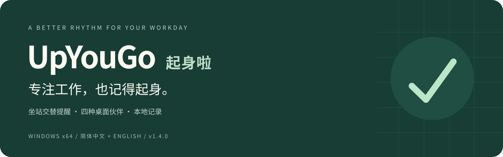
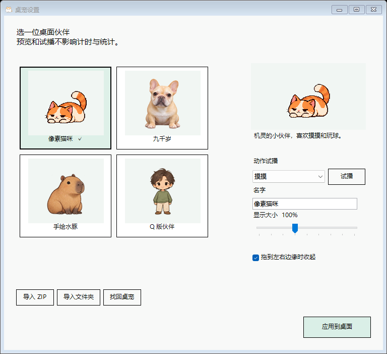
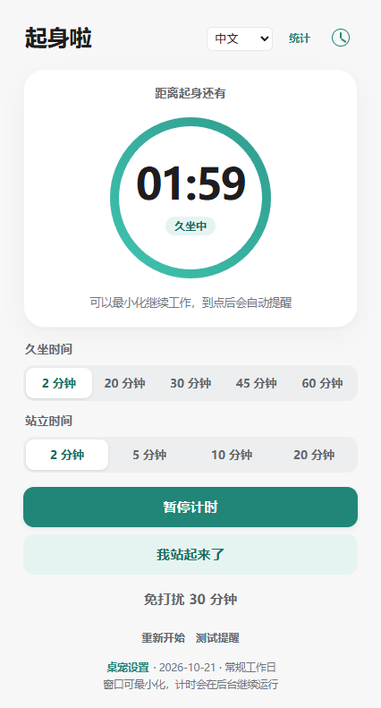
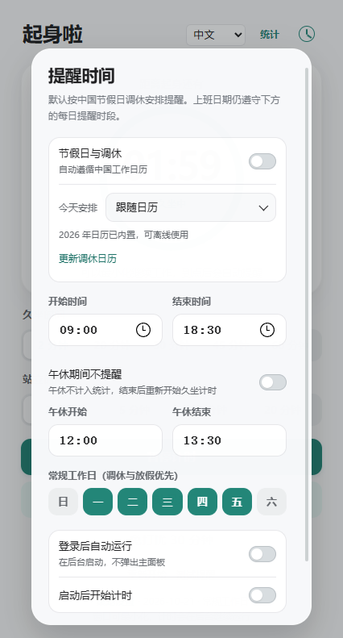

  

  <strong>让工作有节奏，让桌面有陪伴。</strong> 
  为 Windows 办公场景设计的坐站提醒与桌面伙伴。

  <a href="https://github.com/elvinzou/upyougo-releases/releases/latest"><strong>下载最新版 1.4.2</strong></a>
  · <a href="USER_GUIDE.md">使用指南</a>
  · <a href="CHANGELOG.md">版本记录</a>
  · <a href="https://github.com/elvinzou/upyougo-releases/issues">问题反馈</a>

  简体中文 · <a href="i18n/en/README.md">English</a> · <a href="i18n/zh-Hant/README.md">繁體中文</a> · <a href="i18n/ja/README.md">日本語</a> · <a href="i18n/ko/README.md">한국어</a>

---

## 在专注与活动之间，找到自己的节奏

写代码、做设计、处理文档时，很容易忘记自己已经坐了多久。UpYouGo 用清晰的坐站计时、适合工作日的提醒规则和会回应的桌面伙伴，帮你记得换个姿势。

到点后，由你确认站起或坐下；忙的时候可以稍后提醒。工作时段之外、午休或免打扰期间，程序按设置安静下来。无需注册账号，提醒记录保存在本地。

## 选择一位合拍的桌面伙伴

从像素猫、九千岁、手绘水豚到 Q 版伙伴，每种外观都有对应的动作与回应。单击摸摸，右键给零食或玩球；也可以调整名字、大小和位置，让它自然地待在桌面一角。

- **四种外观，即时切换**：切换角色和试播动作不改变真实计时。
- **轻互动，有回应**：摸摸、投喂、玩球，以及确认姿势后的简短回应。
- **贴边陪伴，留出空间**：拖到左右边缘可收起，鼠标靠近或提醒到点时展开。
- **自己的角色，自己选择**：支持导入符合格式的本地文件夹或 ZIP 角色包。

*上图由程序实际使用的角色渲染器生成；不同角色的画风和动作设计各有区别。*

查看桌宠设置界面

## 提醒像对话一样，出现在伙伴身边

气泡优先出现在桌宠头顶，空间不足时自动调整位置。起身与坐下都有明确的确认操作，也保留“稍后提醒”，让下一步一眼可见。

| 你正在做什么 | UpYouGo 如何配合 |
| --- | --- |
| 专注输入 | 提醒气泡不抢当前输入焦点 |
| 暂时不方便起身 | 可延后 2 / 5 / 10 分钟，或开启免打扰 |
| 全屏工作或演示 | 支持自动静默，并可在设置中关闭 |
| 锁屏、睡眠或离开电脑 | 按离开规则冻结计时，返回后继续或重新开始 |
| 希望桌面更安静 | 尊重 Windows 减少动态效果设置 |

*上图为实际 WinForms 控件与角色渲染的组合预览，时间数值为示例。*

## 为完整的工作日准备

| 能力 | 说明 |
| --- | --- |
| 坐站交替计时 | 自定义坐姿与站姿时长，支持暂停、继续和姿势确认 |
| 工作日程 | 工作时间、星期、可选午休、中国节假日与调休，以及当天覆盖 |
| 桌宠个性化 | 四种内置外观、改名、70%–150% 大小、动作试播与贴边 |
| 本地角色包 | JSON + PNG，支持文件夹或 ZIP 导入；素材独立保存，更新不覆盖 |
| 时间与行为记录 | 日、周、月、年统计及提醒响应反馈，数据保存在本机 |
| 备份与恢复 | 将设置、统计和行为记录导出为个人备份，恢复前校验并留存当前副本 |
| 中英文界面 | 即时切换并保存选择，不重置计时 |
| 安装与更新 | 自选安装目录、版本提示、在线/本地更新、校验及启动失败回退 |

<table>
<tr><th>坐站计时</th><th>工作日程</th></tr>
<tr>
<td align="center"></td>
<td align="center"></td>
</tr>
</table>

*界面截图来自隔离配置下的实际程序；日期、统计与倒计时为演示数据。应用界面支持简体中文和 English，文档提供其他语言索引。*

## 三步开始

1. **下载安装**：从 [Releases](https://github.com/elvinzou/upyougo-releases/releases/latest) 下载并运行 **UpYouGo-Setup.exe**。
2. **设置节奏**：选择坐站时长、工作日程与可选午休，开始计时。
3. **选择伙伴**：在主面板底部打开“桌宠设置”，选择外观、调整大小或导入角色包。

| 下载文件 | 用途 |
| --- | --- |
| **UpYouGo-Setup.exe** | 推荐方式，安装或升级，支持选择目录 |
| UpYouGo-Windows-x64.zip | 完整便携包或本地更新包，需要全部解压 |
| UpYouGo-Windows-x64.zip.sha256 | 完整性校验文件，客户端更新时自动使用 |

**运行环境**：Windows x64，建议 Windows 10/11 与 .NET Framework 4.8；主面板需要 [Microsoft Edge WebView2 Runtime](https://developer.microsoft.com/microsoft-edge/webview2/)。安装包不包含完整 WebView2 Runtime。

关闭主面板后程序仍在托盘运行。首次使用、角色包导入和旧版迁移，详见 [使用指南](USER_GUIDE.md)。

## 1.4.2 有什么新变化？

本次升级修复桌宠绘图报“内存不足”时中断计时刷新的问题：绘图失败保留上一帧、延迟重试，资源恢复后自动继续显示。同时加入重启与更新后接续计时，保留坐站阶段、暂停和延后进度。

保留四角色、轻互动、贴边、角色包导入、备份恢复与更新校验。[查看完整更新记录 →](CHANGELOG.md)

## 本地数据，清楚可控

个人设置、统计与行为记录保存在本机，不上传这些记录。联网用于版本检查、下载和日历同步；核心提醒不依赖登录或云端服务。

- 设置与记录：`%APPDATA%\LumbarReminder`
- 自定义角色：`%APPDATA%\LumbarReminder\characters`
- 备份导出：托盘菜单 → “导出个人数据”
- 网络与存储说明：[数据说明](docs/PRIVACY.md)

## 使用前了解

- 姿势由你确认，程序不通过摄像头或传感器判断身体动作。
- 短中断且同一工作时段自动接续；较长中断或跨时段等待选择。首次从 1.4.0 或更早版本升级没有旧进度可恢复。
- 个人备份不包含自定义角色素材，迁移角色请另外保留原角色包。
- 安装器和维护工具仍为中文，应用主界面支持中英文。
- 微信截图浮层在具体版本中的表现、真实多显示器与混合 DPI 组合仍需对应环境验证。
- 本页提供 GitHub 独立安装版；完整开发源码保持私有。

遇到问题时，请在 [Issues](https://github.com/elvinzou/upyougo-releases/issues) 提供应用版本、Windows 版本、操作步骤和错误提示。

---

**起身啦 · UpYouGo**

给长时间的专注，留一点活动与陪伴。
