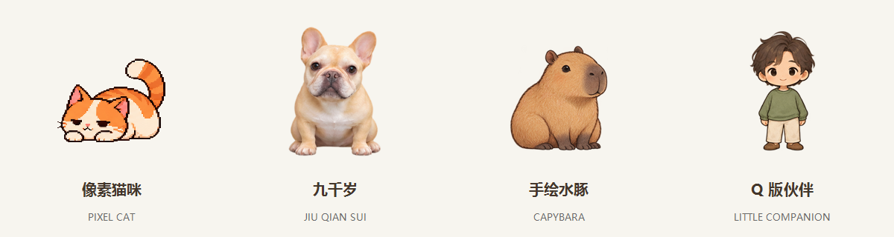
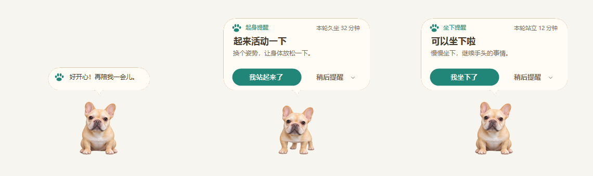

# 起身啦 · UpYouGo

**專注工作，也記得起身。**

適用於 Windows 的坐站交替提醒與桌面夥伴。依照工作日程提醒換個姿勢，提供輕互動與本機統計，無須註冊帳號。

**[下載 1.4.0](https://github.com/elvinzou/upyougo-releases/releases/latest)** · [使用指南](USER_GUIDE.md) · [English](../en/README.md) · [简体中文](../../README.md)

## 選擇一位合拍的桌面夥伴

內建像素貓、九千歲、手繪水豚與 Q 版夥伴。支援摸摸、餵食、玩球、自訂名稱、70%–150% 大小與獨立動作預覽。拖到左右邊緣可收起，滑鼠靠近或提醒到點時展開。

## 提醒融入工作節奏

- 自訂坐姿與站姿時長、暫停、繼續、姿勢確認與稍後提醒。
- 工作時間、星期、中國節假日與調休、當天覆寫和可選午休。
- 不搶輸入焦點的對話氣泡、手動勿擾、全螢幕靜默與減少動態效果。
- 支援 JSON + PNG 角色包，以資料夾或 ZIP 匯入；普通照片不會自動生成動畫。
- 設定、統計及行為紀錄保存在本機，支援備份與還原；自訂角色素材需另外保留。

## 安裝與使用

從 Releases 下載 UpYouGo-Setup.exe，選擇可寫入的獨立資料夾，再設定時長與日程。主面板底部的「桌寵設定」可更換角色。便攜版需完整解壓縮 ZIP。

## 執行需求與範圍

需要 Windows x64、.NET Framework（建議 4.8）及 Microsoft Edge WebView2 Runtime；建議 Windows 10/11。應用程式介面支援簡體中文與 English，安裝程式及維護工具仍為簡體中文。這裡提供繁體中文文件，不代表程式已有繁體介面。

更新與重新啟動不會接續原倒數；設定及歷史紀錄保留。1.4.0 加入四角色、貼邊、角色包與氣泡改版，修復臨時全螢幕結束後桌寵多隱藏 10 秒的問題。特定微信版本與實際多螢幕／混合 DPI 環境仍需實機確認。

[1.4.0 · English](../en/CHANGELOG.md) · [角色包格式](../../docs/CHARACTER-PACKS.md) · [Issues](https://github.com/elvinzou/upyougo-releases/issues)
